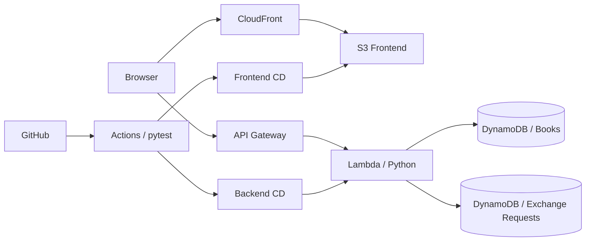

# BookSwap Cloud

以 **Python 與 AWS Serverless** 建置的書籍交換平台，提供書籍管理與交換申請功能，並透過 GitHub Actions 實作自動化測試及部署。

**[Live Demo](https://d2rx9whcti8exi.cloudfront.net/)** · **[Source Code](https://github.com/Ronnieea/bookswap-cloud)**

## 核心功能

- **書籍管理**：瀏覽、搜尋、新增、編輯及刪除書籍；顯示書名、作者、ISBN 與交換狀態。
- **ISBN 查詢**：透過後端 API 查詢外部書籍資訊，輔助填入書名與作者。
- **交換申請**：對可交換的書籍送出申請，並查看申請紀錄。

## 技術架構

| 層級 | 使用技術 | 用途 |
| --- | --- | --- |
| Frontend | HTML、CSS、JavaScript、Bootstrap | 網頁介面與 API 呼叫 |
| Hosting | Amazon S3、CloudFront | 靜態網站儲存與內容傳遞 |
| Backend | Python 3.12、AWS Lambda、API Gateway | Serverless API |
| Database | Amazon DynamoDB | 儲存書籍與交換申請資料 |
| DevOps | AWS SAM / CloudFormation、GitHub Actions | 基礎設施管理、測試與部署 |

## CI/CD 與測試

- **CI**：GitHub Actions 執行 **14 個 pytest 測試**。
- **Frontend CD**：部署前端至 S3，並執行 CloudFront 快取清除。
- **Backend CD**：更新 Lambda 程式碼，並以 API Smoke Test 驗證部署結果。
- **資料保護**：DynamoDB 資料表設定 `DeletionPolicy: Retain` 與 `UpdateReplacePolicy: Retain`，並建立過一次 On-Demand Backup。

## 設計重點與限制

- 採用 Serverless 架構，無須自行維護常駐應用伺服器。
- 書籍與交換申請分別存放於兩張 DynamoDB 資料表。
- 目前 API Gateway 呼叫 Lambda `$LATEST`；尚未實作 Alias 切換與自動回滾。
- 書籍封面功能尚未完成驗收，不列入核心功能。

> 本專案為實作測驗作品，重點在於 Python API、AWS 雲端服務整合及 CI/CD 流程。
