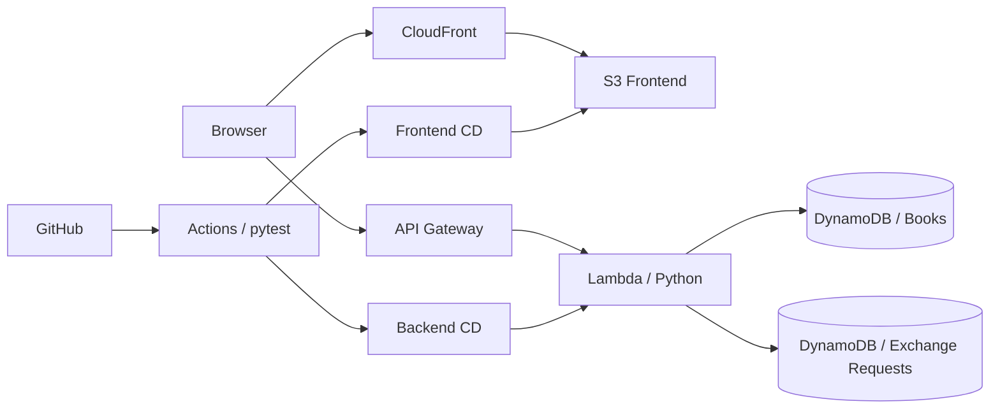
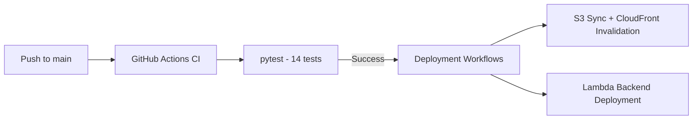

# BookSwap Cloud

以 **Python 與 AWS Serverless** 建置的書籍交換平台，提供書籍管理與交換申請功能，並透過 GitHub Actions 實作自動化測試及部署。

- **Demo：** https://d2rx9whcti8exi.cloudfront.net
- **Repository：** https://github.com/Ronnieea/bookswap-cloud

## 核心功能

- **書籍管理**：瀏覽、搜尋、新增、編輯及刪除書籍；顯示書名、作者、ISBN 與交換狀態。
- **ISBN 查詢**：透過後端 API 查詢外部書籍資訊，輔助填入書名與作者。
- **交換申請**：對可交換的書籍送出申請，並查看申請紀錄。

## 雲端架構

## 使用工具

| 層級 | 使用技術 | 用途 |
| --- | --- | --- |
| Frontend | HTML、CSS、JavaScript、Bootstrap | 網頁介面與 API 呼叫 |
| Hosting | Amazon S3、CloudFront | 靜態網站儲存與內容傳遞 |
| Backend | Python 3.12、AWS Lambda、API Gateway | Serverless API |
| Database | Amazon DynamoDB | 儲存書籍與交換申請資料 |
| DevOps | AWS SAM / CloudFormation、GitHub Actions | 基礎設施管理、測試與部署 |

## 加分項目實作

### 1. 前端程式開發

使用 **HTML、CSS、JavaScript 與 Bootstrap** 實作書籍列表、搜尋、表單及交換申請介面，並以 JavaScript 呼叫後端 API。

### 2. 第三方 RESTful API

透過 **ISBN 查詢書籍資訊**，自動帶入書名與作者。第三方資料可能不完整，因此仍保留手動輸入方式。

### 3. CI/CD 流程

使用 **GitHub Actions** 執行 Python 自動化測試，並在測試成功後部署前後端；後端另以 API Smoke Test 檢查部署結果。

### 4. Infrastructure as Code（IaC）

使用 **AWS SAM / CloudFormation** 定義並部署雲端資源。

### 5. AI 輔助開發

使用 **ChatGPT** 輔助討論系統架構、產生部分程式碼範例、分析錯誤訊息與整理部署步驟；實際執行、測試及AWS部署結果仍需人工確認。
